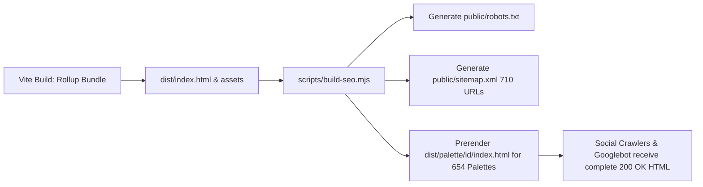

# Production Deployment & SEO Guide

This reference details the static site generation (SSG), prerendering pipeline, and hosting configurations for PS Color.

---

## 1. Static Prerendering Architecture

### Why Prerendering is Essential:
1. **Social Sharing**: Discord, Twitter/X, Slack, Facebook, and LinkedIn do not execute JavaScript when generating card unfurls. With prerendered HTML, each palette share displays the exact palette title, description, and SVG preview.
2. **Instant FCP/LCP**: Users on slow connections see the visual color stack immediately before client JS hydrates.

---

## 2. Multi-Platform Hosting Setup

| Platform | Configuration File | Behavior |
| :--- | :--- | :--- |
| **Vercel** | [`vercel.json`](file:///D:/Docker/PS%20color/vercel.json) | Rewrites all routes to `/index.html`, configures immutable asset caching, and injects security headers. |
| **Netlify** | [`public/_redirects`](file:///D:/Docker/PS%20color/public/_redirects) | Provides `/* /index.html 200` rewrite. |
| **Cloudflare Pages** | [`public/_redirects`](file:///D:/Docker/PS%20color/public/_redirects) | Direct compatibility with Netlify redirect rules. |
| **Docker / Nginx** | [`Dockerfile`](file:///D:/Docker/PS%20color/Dockerfile) & [`nginx.conf`](file:///D:/Docker/PS%20color/nginx.conf) | Multi-stage build deploying to alpine Nginx with Gzip and `try_files $uri $uri/ /index.html`. |
