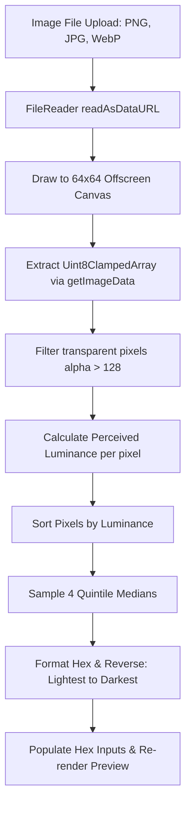

# Image-to-Palette Extraction Guide

PS Color provides client-side color extraction capable of processing user photos without transmitting image bytes to a remote server.

---

## 1. Algorithmic Workflow

---

## 2. Key Engineering Principles

1. **Canvas Downsampling**:
   Instead of iterating over multi-megapixel photos (e.g., $4000 \times 3000 = 12\text{M}$ pixels), the image is scaled onto an offscreen $64 \times 64$ canvas ($4,096$ pixels). This reduces extraction time to **$< 20\text{ms}$** while naturally blending micro-noise.

2. **Perceived Luminance Sorting**:
   Pixels are sorted according to standard photopic weights:
   $$Y = 0.299R + 0.587G + 0.114B$$
   By sampling at regular quantile intervals across the sorted luminance spectrum, the algorithm guarantees a balanced set spanning light highlights, mid-tones, and deep contrasting accents.

3. **Alpha Filtering**:
   Pixels with $\text{alpha} \le 128$ are discarded to avoid extracting transparent background canvas artifacts.
